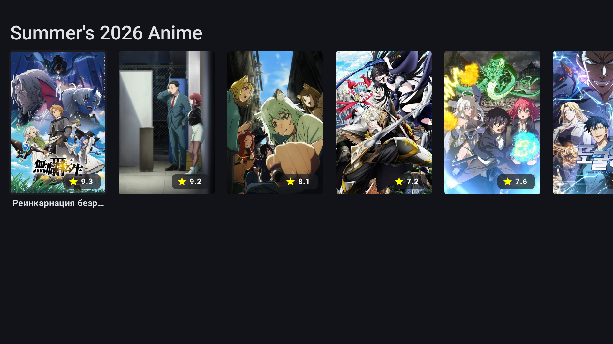
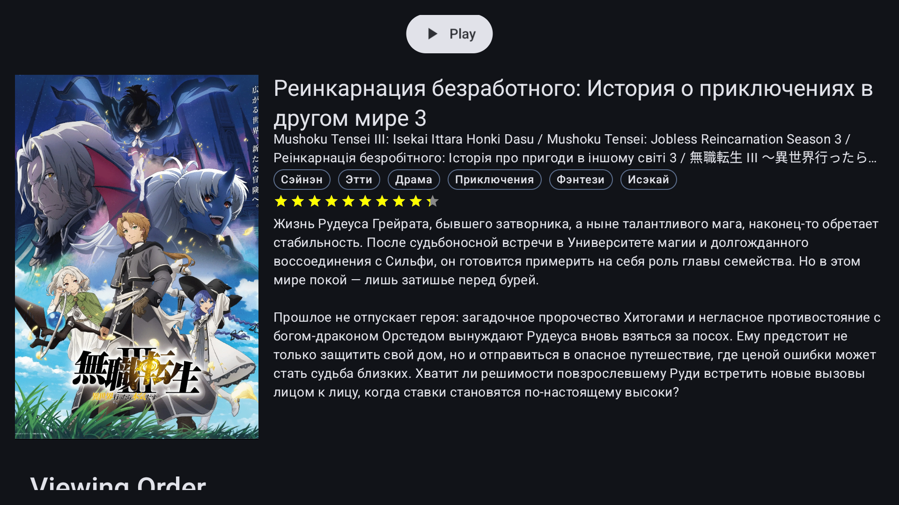
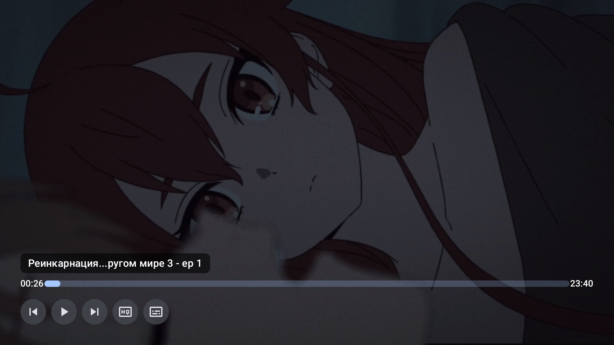
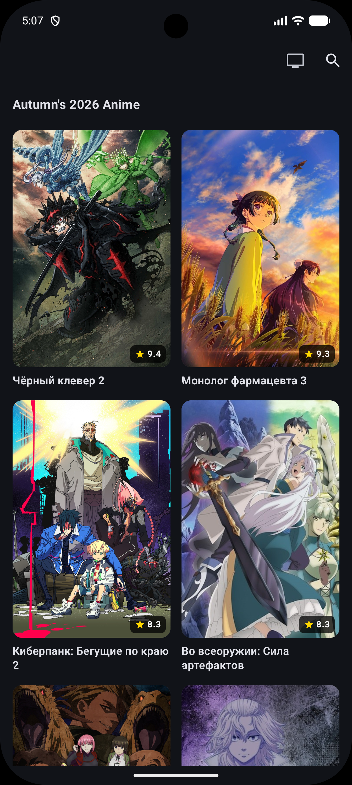
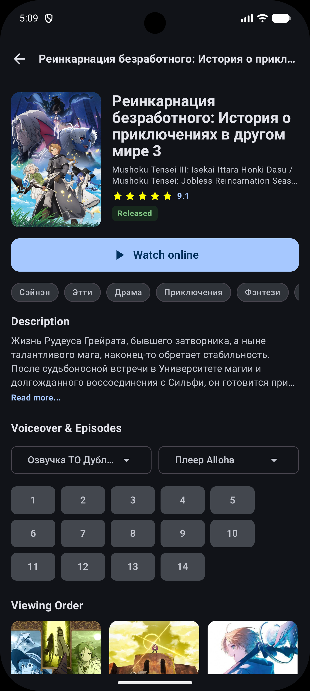
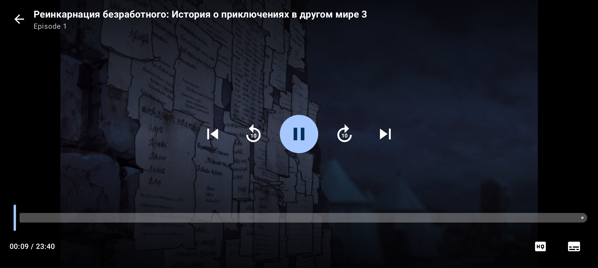

# DAVY

[](LICENSE)
[](https://github.com/AsfhtgkDavid/davy/issues)
[](https://f-droid.org/packages/dev.daika.davy/)
[](https://codecov.io/github/AsfhtgkDavid/davy)

DAVY is a modern, lightweight, and ad-free Android app for discovering and watching anime on phones,
tablets, Android TV, and Google TV. Designed to feel fast and approachable, it helps you go straight
from browsing the current season to watching episodes without clutter.

## Highlights

- **Adaptive Experience**: Switch between a touch-friendly mobile layout and a focus-driven TV
  interface optimized for D-pad and remote controls. You can pick your preferred mode right at
  startup.
- **Seasonal Lineup & Fast Search**: Stay up to date with ongoing titles from the current anime
  season or search the catalog for specific shows.
- **Detailed Anime Pages**: View synopses, genres, ratings, watch order, and organized
  episode lists in one place.
- **Flexible Sources & Audio**: Choose between multiple dubbing studios, original audio, subtitles,
  and video sources.
- **Smart Built-in Player**:
    - Automatic mirror failover for uninterrupted playback
    - Quick screen orientation toggle on mobile devices
    - Smart screen wake-lock so your display never dims while watching
- **Multi-Language Interface**: Available in English, Russian, and Ukrainian.
- **Open Source & Private**: No ads, no tracking, and no unnecessary permissions.

> **Note:** Streaming sources primarily provide content in Russian, though many titles can be
> watched in their original audio with subtitles.

## Screenshots











## Roadmap

- [x] Current season anime browsing
- [x] Built-in player with mirror failover & orientation controls
- [x] Search ([#3](https://github.com/AsfhtgkDavid/davy/issues/3))
- [x] Dedicated mobile & Android TV interfaces
- [x] Multi-language support (EN / RU / UK)
- [ ] Local watch history
- [ ] Integration with MyAnimeList and other watchlists
- [ ] Support for additional anime aggregators

## Donate

If you find DAVY helpful, consider supporting the project with a cryptocurrency donation:

- **TON/Gram (Toncoin)**: `UQD6fbJ73BmC7qPgoR_UrilSBu6kcBMPeNg-J9ZHlZOE1gFQ`
- **BTC (Bitcoin)**: `bc1q5xmq99krq0vykhzpgc5upl5vzttfdl2feflf53`
- **ETH (Ethereum)**: `0x87B0F2f291015Acd4a2A941cefE492F56E362d11`
- **XMR (Monero)**:
  `8Bf41hGnngn1S8vHzaRuTg14VfowCWU1nLQUmWerudh11fSZVDGMuXu4qSmnpoCw8tWbKYBPc6KWEWHb1PvjNTy1Q4SUywR`

Every contribution helps keep the project alive and funded!

## Contributing

Contributions are welcome! Please read [CONTRIBUTING.md](CONTRIBUTING.md) for the development
workflow, architecture overview, and pull request guidelines.

If you want to add support for new player parsers, please contribute to the standalone parser
library:

- [davy-parsers](https://github.com/AsfhtgkDavid/davy-parsers)

Before submitting a pull request, make sure the project builds cleanly:

```bash
./gradlew assembleDebug
```

## License

This project is licensed under the GNU Affero General Public License v3.0. See
the [LICENSE](LICENSE) file for details.